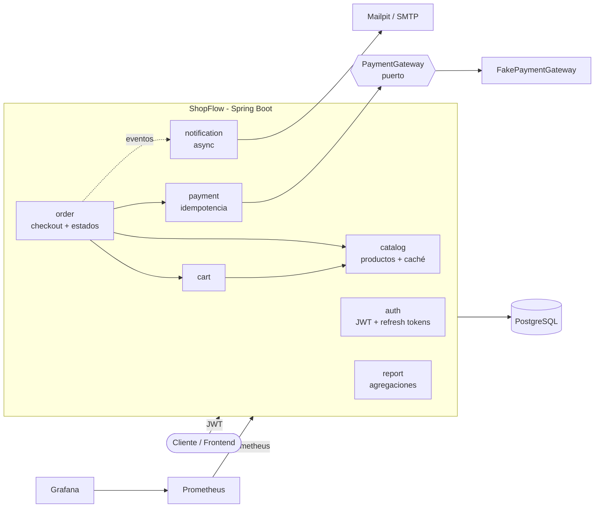
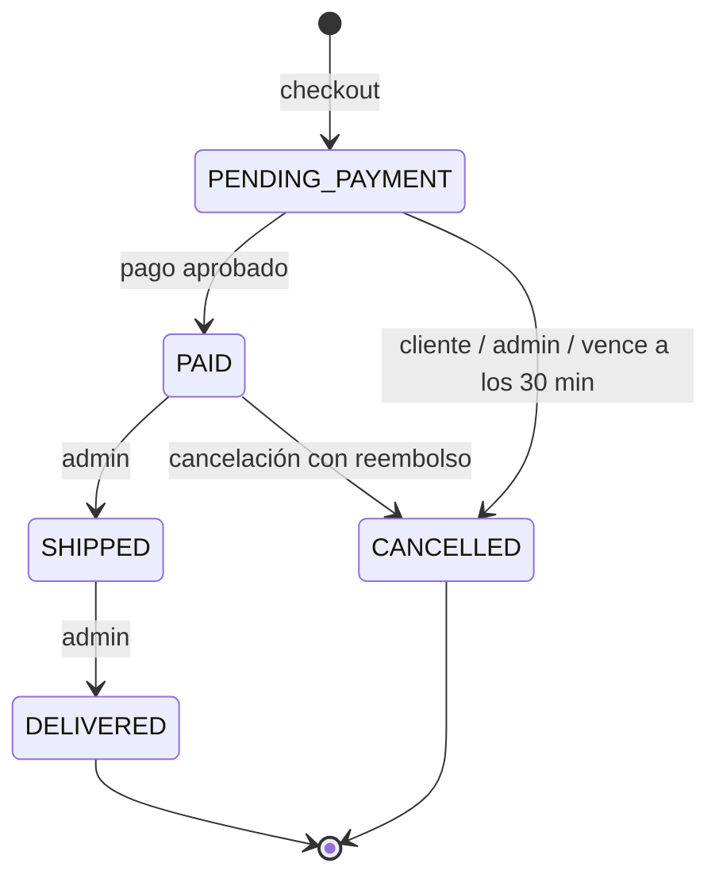
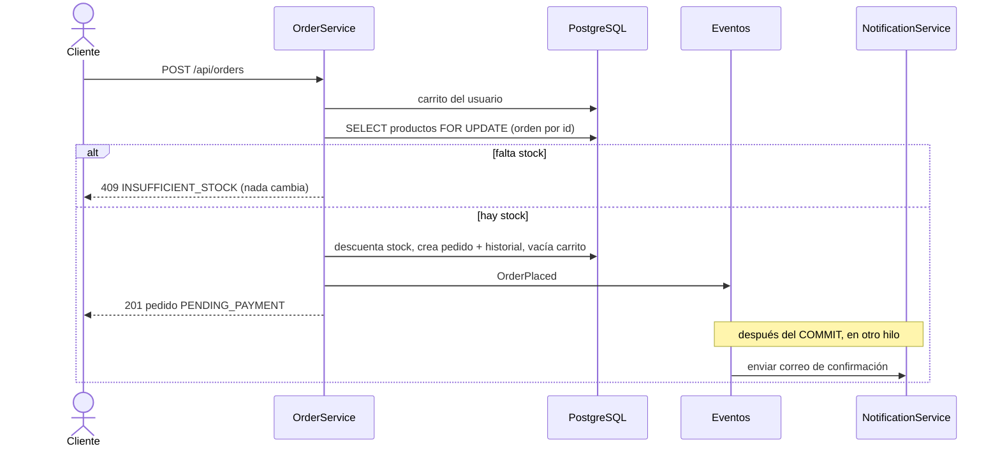
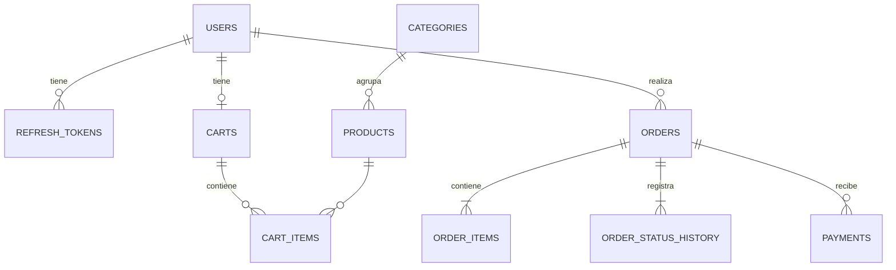

# ShopFlow — Backend de e-commerce con Spring Boot


API REST de una tienda online pensada como un sistema real, no como un CRUD: maneja **compras simultáneas sin sobreventa**, **pagos idempotentes**, una **máquina de estados** para los pedidos, **tareas programadas**, **eventos asíncronos** y **métricas** para monitoreo.

> Proyecto de portafolio. La pasarela de pagos es simulada (tokens de prueba), todo lo demás funciona de punta a punta.

---

## Lo más interesante del proyecto

| Problema real | Cómo lo resuelve |
|---|---|
| Dos clientes compran la última unidad al mismo tiempo | `SELECT … FOR UPDATE` sobre los productos, en orden fijo por id para evitar *deadlocks*. Un test lanza 12 compras concurrentes contra 5 unidades y verifica que se vendan **exactamente 5**. |
| El cliente reintenta el pago por un timeout de red | Header `Idempotency-Key`: el mismo intento nunca se cobra dos veces. Además se bloquea el pedido para que dos pagos distintos no lo cobren en paralelo. |
| Pedidos que se crean y nunca se pagan bloquean stock | `@Scheduled` cancela los pedidos `PENDING_PAYMENT` con más de 30 min y repone el stock. |
| El correo falla y tumba la compra | Eventos de dominio con `@TransactionalEventListener(AFTER_COMMIT)` + `@Async`: la notificación corre después del commit y en otro hilo. |
| Robo de refresh token | Rotación de refresh tokens con **detección de reutilización**: si se usa un token ya rotado, se revocan todas las sesiones del usuario. |
| Fuerza bruta en el login | Límite de 5 intentos fallidos por cuenta en 15 minutos (`429 Too Many Requests`). |
| Cambia el precio de un producto después de una compra | Los ítems del pedido guardan una **copia** del nombre, SKU y precio al momento de la compra. |
| Transiciones inválidas (entregar algo no pagado) | `OrderStatus` define las transiciones permitidas y cada cambio queda en un **historial de auditoría**. |

## Stack

**Java 21** (records, `switch` con patrones, virtual threads) · **Spring Boot 4.1** · Spring Security (OAuth2 Resource Server / JWT) · Spring Data JPA + Hibernate 7 · **PostgreSQL 17** · **Flyway** · Caffeine Cache · Spring Mail · Micrometer + **Prometheus** · springdoc-openapi (Swagger) · JUnit 5 · **Testcontainers** · JaCoCo · Docker · GitHub Actions

## Arquitectura

Monolito modular organizado **por funcionalidad** (no por capas técnicas): cada paquete contiene su entidad, repositorio, servicio, controlador y DTOs.



`PaymentGateway` es una interfaz (patrón *puerto y adaptador*): integrar Culqi, Mercado Pago o Stripe sería escribir un adaptador nuevo sin tocar la lógica de pedidos.

### Ciclo de vida de un pedido



### Checkout



### Modelo de datos



El esquema se versiona con **Flyway** (`src/main/resources/db/migration`), e Hibernate solo lo **valida** (`ddl-auto=validate`), como en producción.

## Cómo ejecutarlo

Requisitos: **Java 21** y **Docker**.

**Opción 1: stack completo con Docker Compose**

```bash
docker compose up --build
```

| Servicio | URL |
|---|---|
| Swagger UI | http://localhost:8080/swagger-ui.html |
| Bandeja de correos (Mailpit) | http://localhost:8025 |
| Prometheus | http://localhost:9090 |
| Grafana | http://localhost:3000 |

**Opción 2: modo desarrollo con Testcontainers** (levanta PostgreSQL automáticamente, sin configurar nada)

```bash
./mvnw spring-boot:test-run
```

Usuario administrador por defecto: `admin@shopflow.dev` / `Admin12345` (cámbialo con `ADMIN_EMAIL` y `ADMIN_PASSWORD`).

En [`docs/requests.http`](docs/requests.http) hay un flujo completo listo para ejecutar desde IntelliJ o VS Code.

## Tests

```bash
./mvnw verify      # tests + reporte de cobertura en target/site/jacoco/index.html
```

**44 tests** · **~91% de cobertura de líneas**

- **Integración** (`@SpringBootTest` + MockMvc + PostgreSQL real con Testcontainers): flujo de compra completo, pagos rechazados e idempotentes, cancelación con reembolso, máquina de estados, aislamiento entre usuarios, caché, autorización por roles, rotación de tokens, fuerza bruta, job de pedidos vencidos, reportes.
- **Concurrencia**: 12 hilos compran a la vez 5 unidades → exactamente 5 pedidos, stock final 0.
- **Unitarios** (sin Spring): máquina de estados (parametrizado), cálculo de totales, limitador de intentos con reloj controlable, política de envío, pasarela simulada.

## Endpoints principales

| Método | Ruta | Rol |
|---|---|---|
| POST | `/api/auth/register` · `/login` · `/refresh` · `/logout` | público |
| GET | `/api/products?q=&category=&minPrice=&maxPrice=&inStock=` · `/api/products/{id}` · `/api/categories` | público |
| GET/POST/PUT/DELETE | `/api/cart` · `/api/cart/items/{productId}` | cliente |
| POST/GET | `/api/orders` · `/api/orders/{id}` · `/api/orders/{id}/cancel` | cliente |
| POST | `/api/orders/{id}/payments` (header `Idempotency-Key`) | cliente |
| POST/PUT/PATCH/DELETE | `/api/admin/products/**` · `/api/admin/categories` | admin |
| GET/PATCH | `/api/admin/orders` · `/api/admin/orders/{id}/status` | admin |
| GET | `/api/admin/reports/sales?from=&to=` | admin |

Los errores siguen el estándar **RFC 9457 (Problem Details)** con un `code` estable:

```json
{
  "status": 409,
  "title": "Conflict",
  "detail": "Algunos productos no tienen stock suficiente",
  "code": "INSUFFICIENT_STOCK",
  "items": [{ "productId": 8, "name": "Monitor 27\" QHD IPS 165Hz", "requested": 3, "available": 1 }]
}
```

Tokens de pago de prueba: `tok_visa`, `tok_mastercard` (aprobados) · `tok_declined`, `tok_insufficient_funds` (rechazados → `402`).

## Observabilidad

- `/actuator/health/liveness` y `/readiness` (listos para Kubernetes).
- Métricas de negocio propias en Prometheus: `shopflow_orders_placed_total`, `shopflow_orders_cancelled_total`, `shopflow_payments_total{status=...}`.

## Estructura

```
src/main/java/io/github/johaosalazarcuyos/shopflow
├── auth/          JWT, refresh tokens con rotación, límite de intentos
├── catalog/       productos, categorías, búsqueda con Specifications, caché
├── cart/          carrito por usuario
├── order/         checkout, máquina de estados, historial, job de vencidos
├── payment/       pagos idempotentes, puerto PaymentGateway + simulador
├── notification/  eventos async → correo + registro de notificaciones
├── report/        reportes de ventas (JPQL con agregaciones)
├── user/          usuarios, roles, admin inicial
├── config/        seguridad, propiedades tipadas, OpenAPI, infraestructura
└── common/        errores (ProblemDetail), auditoría JPA, utilidades
```

## Próximos pasos

- Outbox transaccional para garantizar la entrega de notificaciones si la app se cae.
- Integración real con una pasarela peruana (Culqi / Niubiz) vía webhooks firmados.
- Limitador de intentos y caché distribuidos en Redis para varias réplicas.
- Frontend en React/Angular consumiendo esta API.
